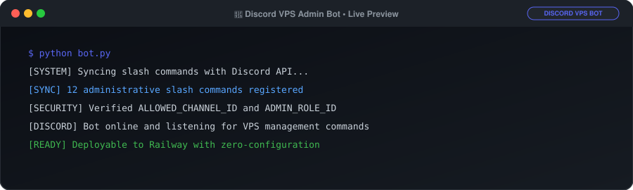

<h1 align="center">🤖 Discord VPS Admin Bot</h1>

  

    

---

## 📸 Project Preview

  

---

# 🚀 Overview

A production-ready Discord bot engineered for instant **Railway** hosting to supervise, administer, and manage cloud VPS instances through role-gated slash commands.

---

# 🏗️ System Architecture & Data Flow

  

 

Discord application commands are intercepted by the bot gateway, authenticated through role and channel permissions, and executed against server management endpoints.

---

# ✨ Features

✅ **Railway Native**: Includes `railway.json` and `Procfile` for one-click deployment.\n✅ **Role Security**: Strict admin role (`ADMIN_ROLE_ID`) and channel (`ALLOWED_CHANNEL_ID`) gating.\n✅ **Slash Commands**: Fast, modern Discord UI interaction.

---

# 📦 Installation & Quickstart

### Deploy to Railway\n\n\n1. Import into Railway.\n2. Set `DISCORD_TOKEN` in the Variables tab.\n3. Railway automatically starts `bot.py`.

---

# 👤 Author & Support
- Built with ❤️ by [@itzxsahil](https://github.com/itzxsahil)
- Star ⭐ this repository if you find it helpful!
