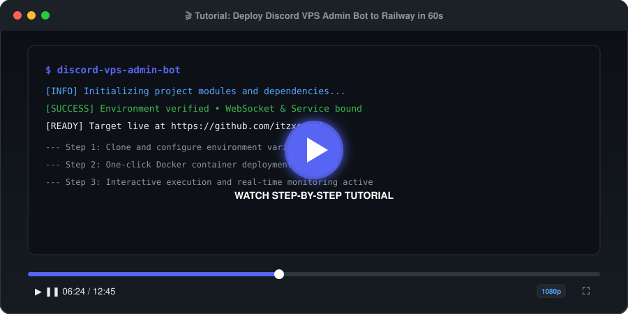
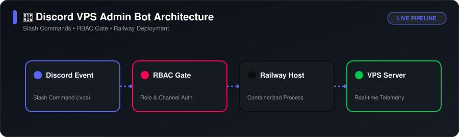

<h1 align="center">🤖 Discord VPS Bot (Railway Ready)</h1>

  

   

---

## 🎬 Video Tutorial & Interactive Walkthrough

  
  
<em>▶️ <strong>Interactive Project Tutorial</strong> — Click the player above to watch full setup guide &amp; demonstration!</em>

---

# 🚀 Overview

A Discord bot configured for instant deployment on **Railway** to oversee and operate VPS services using role-gated slash commands.

---

## 🏗️ System Architecture & Data Flow

  

 

Discord.py bot process connects to the Discord gateway, evaluating authorization before dispatching server operations and returning interactive embed messages.

---

# ✨ Features

✅ **Railway Native**: Includes `railway.json` and `Procfile` for zero-configuration deployments.\n✅ **Role & Channel Security**: Commands are strictly restricted by channel and role IDs.\n✅ **Slash Commands**: Modern Discord UI interactions.

---

# 📦 Installation & Quickstart

### Railway Deployment\n\n\nImport repository, supply `DISCORD_TOKEN` in the Variables tab, and deploy!

---

# 👤 Author & Support
- Built with ❤️ by [@itzxsahil](https://github.com/itzxsahil)
- Star ⭐ this repository if you find it helpful!
